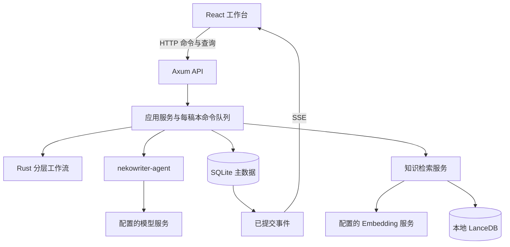

# NekoWriter MVP 实现方案

文档状态：实施基线与进度说明，D01–D16 补充约定已全部由用户确认；实现正在按本文和细则推进。  
最近更新：2026-09-11。  
依据：[`NekoWriter.txt`](../NekoWriter.txt)、[`AGENTS.md`](../AGENTS.md)、现有 `webui/`。  
配套文档：[`实现细则`](02-implementation-spec.md)。本文确定产品与架构取舍，细则确定状态、数据、协议和验收行为。

## 1. 结论与产品定位

NekoWriter 应当是一款以小说正文为中心、允许人随时介入的本地 AI 写作工作台。核心体验是：设定目标 → 审核准备产物 → 逐章指导与写作 → 审核定稿 → 完本与番外。

推荐采用 **React 单页前端 + 单进程 Rust 后端 + SQLite 主存储 + 嵌入式 LanceDB**。浏览器承载界面，Rust 进程负责 Agent、状态推进、数据写入及模型请求。前端关闭后任务仍由本地进程管理；进程关闭后不再执行模型调用。

生产级质量在这里体现为正文不误写、意见不丢失、审核不串版、任务中断可解释、数据可导出、界面适合长时间阅读。部署目标是个人电脑，不引入账户体系、多租户、微服务、Redis、消息中间件、容器集群或云端控制平面。

“可扩展”落实到明确的模块边界、带类型的阶段与工具、可替换的模型及能力接口。MVP 不做可视化流程编排器、运行时插件装载器或通用工作流 DSL。

## 2. 当前项目与版本基线

当前工作区已有四 crate Rust workspace（`nekowriter-core`、`nekowriter-agent`、`nekowriter-store`、`nekowriter-app`）、SeaORM 2 / SQLite 存储、LanceDB 烟测、Axum 本地 API 与 React 工作台。当前目录不是 Git 仓库，本文不假定已有提交历史。

前端使用 React 19、TypeScript 6、Vite 8、Tailwind CSS 4、shadcn/Base UI、Lucide 和主题组件。沿用这些依赖及现有 CSS 变量；按实际界面需要添加 shadcn 组件，不整体替换 UI 基础。

截至本次更新，M0 已完成。M1 的数据模型、状态转换、命令回执、SSE、Chat Completions 兼容适配器、Windows 凭据引用、模型设置与连接测试、准备阶段自动生成、章节细纲自动生成、正文 Agent 的 `append_content` / `replace_content` 循环、人工审核、整章审核和阶段纯文本折叠均已有实现。模型请求按稿本串行、全局并发为 1；准备、细纲和正文的成功回调与产物/工具结果/审核/事件在 SQLite 事务中提交，后续请求按已完成阶段的纯文本 fold 及当前 Run 消息账本构建。

M2 已完成的交互闭环包括：正文 `ApproveRequired` 提案及基础修订重验、暂停到工具/提交边界、自由意见批次的原子绑定与投递、直接终态提交的完成守卫、`ask_user` 问答、命令 ID 幂等重试、SSE 游标恢复、进程中断后的显式继续及每次 100 次请求额度续授。完整但不符合阶段协议的模型响应会保留原文和诊断，向同一 Run 追加纠正指令；连续三次才停止，显式继续后才可再次发送。用户显式停止会在同一事务中作废 prepared/dispatched attempt，并中止本地在途 HTTP 任务；迟到回调无法再推进工作流。待答问题、待审提案和暂停边界在继续后恢复原状态。界面据停止原因区分额度耗尽、协议错误与用户停止。

准备产物、章节细纲、逐次正文编辑和整章终稿的审核委托均已接通。委托会创建不带写作工具的审核子 Run，并按审核类型构建独立提示词与受限上下文；合法结论、父工作流推进和阶段折叠在同一事务提交。取消、模型失败或服务重启会使本次 attempt 失效并重新开放 Review；同一成功回调重放只返回已提交快照，不会重复应用决定。

尚未完成的边界必须保持明确：引用与附件性反馈、项目提示词覆盖、知识库与发行交付尚未接通；真实外部模型验收也仍需由配置有效凭据的本机完成。M2 的完整竞态矩阵尚未全部验证，不能因上述闭环存在而标记整个里程碑完成。

| 项目 | 实施选择 | 依据与限制 |
| --- | --- | --- |
| Web 服务 | Axum + Tokio + tower-http | 官方文档提供 SSE 支持，适合单向生成事件推送；查阅版本为 0.8.9。[Axum SSE](https://docs.rs/axum/latest/axum/response/sse/) |
| 关系存储 | SeaORM + SQLite | CRUD 与事务由 SeaORM 实现；查阅版本为 2.0.2。[SeaORM](https://docs.rs/sea-orm/latest/sea_orm/)、[事务文档](https://www.sea-ql.org/SeaORM/docs/advanced-query/transaction/) |
| 向量存储 | LanceDB Rust SDK，本地目录 | 进程内运行，无需额外数据库服务；查阅版本为 0.38.0。[LanceDB Rust](https://docs.rs/lancedb/latest/lancedb/) |
| 服务端状态缓存 | TanStack Query | 管理查询、刷新和请求状态；业务状态以服务端快照为准。[官方说明](https://tanstack.com/query/latest/docs/framework/react/overview) |
| 前端交互状态 | XState | 显式描述分层状态及连接状态等并行区域。[并行状态](https://stately.ai/docs/parallel-states) |
| 长篇阅读 | TanStack Virtual | 按章节虚拟化，保留页面与样式控制权。[官方说明](https://tanstack.com/virtual/latest/docs/introduction) |
| 路由与校验 | React Router；Rust serde + 类型化校验 | 前端只用客户端路由，不引入另一套全栈框架。[声明式路由](https://reactrouter.com/start/declarative/installation) |
| 密钥 | Windows 凭据存储 | Rust 采用 keyring 生态的对应平台存储；具体 API 随锁定版本核验。[当前 keyring 使用说明](https://docs.rs/keyring/latest/keyring/) |

这些版本是查阅时的文档快照，不是已完成的联合构建结果。需求中的 `@latest` 解释为实施起点选择最新稳定版、排除预发布，再提交 `Cargo.lock` 与前端锁文件；不使用浮动 `*`。第一阶段必须验证 Windows 上的 Rust 工具链、LanceDB/Arrow 依赖及前端构建组合，之后按锁文件重现。

## 3. MVP 范围与需求补全

### 3.1 必须交付

| 模块 | MVP 内容 |
| --- | --- |
| Dashboard | Token 使用、进行中任务、正文净字数增量；支持时间范围与项目筛选 |
| 项目 | 创建、重命名、项目设置、小说标题、小说版本、软删除与恢复 |
| 准备阶段 | 背景设定、资料收集、人物设定、小说粗纲；询问用户；四项齐备后集中审核 |
| 正文阶段 | 章节指导、细纲及审核、正文工具编辑、逐次审核/自动接受切换、暂停与意见队列、整章审核 |
| 审核委托 | 准备产物、细纲、每次正文编辑、整章审核均可委托；不同审核使用不同提示词 |
| 阶段上下文折叠 | 当前阶段全部必需产物审核通过后，其历史消息统一折叠为仅含完整产物内容的纯文本，供后续请求使用 |
| 工作台 | 章节导航、连续正文阅读、实时更新、编辑差异高亮、引用、上下文 Dock |
| 提示词 | 内建 system/user 成对条目、系统修改、项目覆盖、变量说明、独立用户模板 |
| 知识库 | Space、知识 CRUD、手动录入、向量检索、索引状态、知识积累接口与空注册表 |
| 能力基础设施 | 联网研究接口与空注册表；MVP 不实现任何研究或知识积累引擎 |
| 本地可用性 | 本地启动、持久化、显式恢复中断任务、正文 Markdown/TXT 导出、基础诊断 |

最后一行中的导出和中断处理是本地实用工具的工程补全项，不是原文逐字要求。

### 3.2 已确认的补充约定（D01–D16）

用户已确认下列 16 项补充约定全部采用本方案决策。它们作为正式需求与实施约束，后续实现直接执行，无需再次逐项确认。其中 D16 采用已纳入“审核通过后阶段历史折叠为产物纯文本”需求后的决策。后续修改这些决定时，应同步修改需求、细则和验收用例。

| 编号 | 原需求问题 | 已确认决策 |
| --- | --- | --- |
| D01 | “细纲撰写完成后交由”未写完 | 交给用户审核，可委托审核 Agent；通过后才进入正文 |
| D02 | 四个准备 Tab 被称为“四个阶段” | 解释为同一准备阶段的四类产物；全部提交后进入统一审核界面 |
| D03 | 小说版本的含义 | 版本是一份独立稿本；项目包含多个稿本，每个稿本有自己的设定、粗纲、章节和工作流 |
| D04 | 字数与 Token 的关系 | 中文写作字数采用不含 Unicode 空白的字符数，标点计入；Token 单独统计 |
| D05 | 何时开始下一章、何时完本 | 粗纲提交有序章节计划；每章通过后停在下一章指导；计划内全部章节通过后由用户确认完本 |
| D06 | 辅助工具预算范围 | 准备阶段一个预算作用域、每章细纲一个预算作用域；修订沿用同一作用域；正文工具免费 |
| D07 | 委托审核是否消耗辅助预算 | 不消耗辅助工具 quota，消耗模型 Token；委托只覆盖本次审核，不自动授权以后审核 |
| D08 | 置信度是否控制通过 | `passed` 决定审核结果，置信度只展示；不擅自加入通过阈值 |
| D09 | “暂停前最近一个 toolcall 返回值” | 指尚未进入下一次模型请求的最近返回值；已发出的请求及历史消息不可原地改写 |
| D10 | 向量由谁生成 | 增加显式 Embedding 配置和一个可用适配器；没有配置时语义检索不可用，手动知识管理仍可使用 |
| D11 | 准备资料依赖联网，但研究引擎实现数为 0 | 如实记录资料来源与缺口，可询问用户；不生成虚构链接或假装已联网 |
| D12 | 基础模型接入 | MVP 交付 Chat Completions 兼容协议适配器，用户填写地址、模型和密钥；不绑定具体模型品牌 |
| D13 | 完本后的番外 | 番外复用章节流程，单独编号；正文完本标记保留，允许多次新增番外 |
| D14 | 切换到自动接受时已有待审编辑 | 模式立即生效，但已有提案仍需明确决定；自动接受适用于后续新编辑 |
| D15 | 正文开始后修改设定或粗纲 | 当前稿本锁定准备产物与计划；需要改变时创建新空稿本，MVP 不自动追溯重写 |
| D16 | 长篇上下文超过模型窗口 | 阶段通过后按新增需求保留产物全文、折叠过程消息；仍超出窗口时明确报错，不自动摘要或裁剪产物 |

“本地工具”表示服务和数据在本地，不等于模型离线。使用远程模型或远程 Embedding 时，相应输入会发送到所配置服务；设置页明确显示服务地址与用途。

### 3.3 明确延后

多人协作、在线账户、云同步、实时协同编辑、全功能富文本编辑器、Git 式分支合并、自动发布、PDF/EPUB 排版、通用工作流编辑器、多种模型协议、具体联网研究引擎、具体知识积累引擎均不进入本次 MVP。

用户直接手改正文也不进入 MVP；正文操作通过指导、意见和 Agent 编辑完成。这可以让首次交付集中验证需求明确要求的审核编辑协议。

## 4. 整体架构



### 4.1 四个 crate 足够

```text
nekowriter/
├── Cargo.toml
├── Cargo.lock
├── rust-toolchain.toml
├── crates/
│   ├── nekowriter-core/       # 领域类型、分层状态、守卫、纯决策函数
│   ├── nekowriter-agent/      # AgentLoop、模型协议、工具描述、上下文、内建提示词
│   │   └── prompts/          # include_str! 嵌入的 Markdown
│   ├── nekowriter-store/      # SeaORM、SQLite 建表、LanceDB、查询及事务
│   └── nekowriter-app/        # 可执行程序、Axum、应用服务、任务调度、能力实现
├── webui/
│   └── src/
│       ├── app/              # 路由、Providers、应用壳
│       ├── features/         # dashboard/projects/workbench/prompts/knowledge/settings
│       ├── components/ui/    # 延用 shadcn/Base UI
│       └── lib/              # HTTP、SSE、生成的 API 类型、工具函数
└── docs/
```

依赖方向：`app → core/agent/store`，`agent → core`，`store → core`，`core` 不依赖另外三个 crate。Core 不引用 Axum、SeaORM、React，也不进行 I/O。App 组合具体存储与 Agent，不为每张表创建一层抽象仓库接口。

仅对确实存在替换需求的边界定义 trait：模型协议、Embedding、联网研究、知识积累，以及 Agent 调用应用工具的 `ToolHost`。流程阶段先使用 Rust enum 与具体处理函数；新增阶段需要改代码、状态转换及测试，无需数据库配置一种编程语言。

### 4.2 状态与执行

服务端工作流是唯一业务事实来源。前端 XState 管理快照呈现、Dock 交互、命令提交和连接状态，不独立判定审核通过或下一阶段。

后端使用两条独立状态轴：

- 工作流轴：初始化 → 准备 → 逐章写作 → 完本 → 可选番外；准备和写作内部各有子状态。
- 执行轴：就绪、请求中、工具边界、等待回答、等待审核、已暂停、已中断、失败。

暂停请求与审核模式是显式控制数据，不通过十几个互相冲突的布尔值拼装页面。工作流保存稿本和阶段，执行状态保存当前请求、工具调用和恢复位置。完整转换规则见细则 §3–§6。

同一稿本的写作命令串行处理，同一项目只运行一份稿本的写作流程；不同项目可排队。MVP 全局最多执行一个模型网络请求，写作与委托审核共用这个调度器；父任务等待审核时释放执行许可，避免子任务死锁。等待用户的任务不占用模型请求许可。

### 4.3 存储分工

SQLite 保存所有不可丢失的业务数据：稿本、正文、不可变修订、审核、意见、任务、工具调用、请求设置快照和统计记录。LanceDB 只保存可由知识正文重新生成的检索数据，不存唯一一份小说正文。

SQLite 与 LanceDB 不共享事务。知识写入先提交 SQLite 的内容修订和索引任务，再由本地任务执行器更新 LanceDB。检索结果须回查 SQLite，过滤已删除条目及过期修订。索引失败必须显示原因和明确的重建操作。

知识检索的 `top_k` 指最终有效结果数。候选过滤后不足时，在同一次检索内继续补取，直到取得足够结果或候选耗尽；补取复用查询向量，不重复扣辅助工具预算。

SQLite 启用 WAL、外键和短事务；WAL 的检查点与文件行为须遵循官方约束。[SQLite WAL](https://www.sqlite.org/wal.html) 模型请求、等待用户以及向量计算均在数据库事务之外。

首次初始化以 `nekowriter-store::entity` 的 SeaORM Entity 注册表为 schema 权威，使用 `SchemaBuilder::apply` 创建表、列、普通唯一键和外键。Entity 属性无法表达的 SQLite partial index 使用 SeaQuery 类型化索引构造器在同一事务补充；不保存手写 `CREATE TABLE` 或 `CREATE INDEX` 字符串。

遵守项目“不保留兼容路径及迁移”的规则：MVP 只有当前 schema 的初始化建表，不做旧版本迁移或双格式读取。遇到不支持的数据版本明确停止打开，保留原文件；不能静默重建数据库。小说的业务修订记录与数据库格式迁移是不同概念。

### 4.4 通信与可靠性

命令走 HTTP JSON，事件走 SSE，正文不依赖 WebSocket。每次状态变化、正文提交、审核判定与对应持久事件在同一 SQLite 事务中提交，事务完成后推送通知。

事件带顺序号，命令带去重 ID，变更带预期资源修订号。刷新或断线后通过快照加事件游标重新同步。SSE 重连只是重订阅，不能重复触发生成。

SSE 首次连接使用快照返回的 `after` 游标；自动重连携带非空 `Last-Event-ID` 时以该请求头为准，URL 中的初始游标不要求随之变化。持久事件按序号去重，生成预览独立处理。

模型 token 增量只用于临时预览；完整参数校验通过后才形成编辑提案。已批准正文、待审差异和未完成流式预览是三种清晰区分的显示状态。

## 5. 核心业务设计

### 5.1 准备阶段

准备 Agent 有四项固定提交目标。它可以询问用户、检索知识，并在存在具体研究引擎时使用联网研究。提交完整后挂起生成，展示四个审核 Tab，每个 Tab 对应一项产物及其当前修订。

背景、资料、人物、粗纲各自审核，四项当前修订全部通过才进入正文。未通过的项进入修订，已通过项不无故重写；如果新修订改变了其他产物的前提，相关审核失效并明确提示重新审核。依赖规则见细则，MVP 不实现任意依赖图编辑器。

资料收集产物允许记录“用户资料”“知识库条目”“模型已有知识，未核验”和“待补充”。没有研究引擎时不会出现一个可点击却无法兑现的联网工具。

### 5.2 正文阶段

每章开始停在章节指导输入处，空指导也可以开始。指导保存成该轮执行的输入快照。细纲通过后进入正文。

正文 Agent 只能使用 `ask_user`、`append_content`、`replace_content`，目标强制限定为当前章节。阶段完成通过结构化响应表达，不能让模型凭自然语言“我写完了”直接推进工作流。

`AutoApprove` 自动接受合法正文编辑，保留每次修订历史；`ApproveRequired` 将每次编辑先展示为差异提案。提交空意见表示接受；提交非空意见表示拒绝本次提案并把意见交给 Agent。两种模式都不自动跳过细纲与整章审核。

章节终稿审核通过后成为本章定稿，用户随后可指导下一章。审核不通过就回到对应产物修订，再次提交审核；工程执行上允许用户停止，不把“不停生成直到通过”实现成无法退出的循环。

模型请求轮次按每轮获准执行的额度限制，初始额度为 100 次。额度耗尽后保存任务，用户显式继续原 Run 时获得新的 100 次额度；累计请求数、已用 Token 和辅助工具预算保留。普通暂停、提交意见和审核通过不刷新额度。

### 5.3 暂停与意见

暂停是工具边界上的控制：点击时先显示“正在等待暂停”，到下一次完整工具调用边界再显示“已暂停”。没有完整工具参数时不提前执行编辑。

用户意见先持久化，再进入 Agent 上下文。同一 Run 的未封存意见组成一个批次；确定交付工具结果后，请求封存前追加的意见继续进入该批次，即使工具结果已经完成。封存时按顺序一次性排空，封存后的新意见进入下一批次。暂停期间提交意见会取消暂停；已经挂起的工具恢复，但仍须遵循当前审核模式。

“取消暂停”不等于“批准待审编辑”，自由意见也不等于回答 `ask_user`。模型终止、请求失败或取消前仍有意见时，界面必须保留其未交付状态。详细并发边界、模式切换和完成响应竞争见细则 §5。

### 5.4 审核委托

所有审核共用审核记录与状态处理，不共用一份笼统提示词。审核 Agent 收到目标修订、相关上下文、用户意见和该审核类型的提示词，返回：

```json
{
  "passed": false,
  "confidence": 0.87,
  "issues": ["第二段中人物称谓与已通过的人物设定不一致。"]
}
```

结果必须完整校验，不能从散文里猜测真假，也不能把调用失败当作通过。结果只对委托时的修订有效。审核 Agent 没有正文编辑工具，不自行修改稿件。

### 5.5 提示词与设置

有效提示词优先级：项目覆盖 → 系统覆盖 → 代码内建。每个内建用途都有 system/user 槽位及变量元数据，使用 `include_str!` 引用 Markdown。用户创建的提示词模板是独立可复用内容，不会仅因同名就覆盖系统提示词。

每个真正发出的模型请求重新读取并解析最新配置，将有效设置、提示词修订和上下文依据保存为该请求的不可变快照。已发出的请求不追溯变化；下一请求使用最新值。模型与思考等级不支持的组合在发请求前报错，不静默忽略。

缓存优化通过稳定的提示词前缀、工具排序和上下文块顺序实现，不为了缓存忽略刚修改的设置。阶段上下文按 §5.6 的明确要求折叠；折叠后的产物文本保持顺序稳定，不能承诺无限上下文或保证供应商缓存命中。

### 5.6 审核通过后的阶段上下文折叠

这是新增的明确需求：当前阶段所有必需产物审核通过后，将该阶段在 Agent 上下文中的历史消息整体替换为仅含审核通过产物内容的纯文本。准备阶段在四项全部通过时折叠；每章细纲通过时折叠细纲阶段；整章终稿通过时折叠该章正文阶段；番外采用同样规则。单次正文编辑被接受时，正文阶段仍在进行，不触发阶段折叠。

折叠使用审核通过的具体修订全文，由程序确定性生成，无需再调用模型。上下文不再携带该阶段的问答、工具调用与返回、修订讨论、审核意见或审核结果 JSON；原始消息和记录仍在本地保存，便于查看和诊断。阶段内尚未通过的修订过程继续保留完整消息。

审核通过、产物修订锁定、折叠检查点和阶段推进必须在同一事务中提交。后续请求使用产物文本及当前阶段的新消息，已发出的请求快照保持不变。具体格式、恢复规则及验收见细则 §9.4。

## 6. UI/UX 方案

### 6.1 信息架构

主导航为“概览 / 项目 / 知识库 / 提示词模板”，底部提供“系统设置”。工作台内提供稿本切换、项目设置和项目提示词覆盖入口。系统提示词管理位于系统设置，避免与用户模板列表混淆。

项目卡片优先显示名称、当前稿本、阶段、最近活动和字数。概览页点击运行任务可以回到对应章节及 Dock 状态。

首次使用流程：配置写作模型并验证连接 → 创建项目和稿本 → 输入小说目标 → 开始准备。Embedding 单独配置；联网研究和知识积累显示“暂无可用引擎”，不要求用户配置不存在的服务。

### 6.2 工作台布局

```text
┌────────────────────────────────────────────────────────────────────────┐
│ 项目 / 稿本 ▾   小说标题       准备 → 正文 → 完本    保存状态  项目设置 │
├──────────────┬─────────────────────────────────────────────────────────┤
│ 章节目录     │ 第三章 · 雨夜的来客                      正文 2,146 字 │
│              │                                                         │
│ 设定与粗纲   │                 连续正文阅读区                          │
│ 一  已通过   │        已提交正文 / 待审差异 / 生成预览                  │
│ 二  已通过   │                                                         │
│ 三  撰写中   │                               [回到生成位置 ↓]          │
│ 四  未开始   ├─────────────────────────────────────────────────────────┤
│              │ Dock：状态、引用、当前输入、明确的主操作                 │
│              │ 已引用：第三章第 4 段 ×                                 │
│              │ [意见输入框……                                       ] │
│              │ 队列 2 条 · 自动接受 ▾       暂停       提交意见         │
└──────────────┴─────────────────────────────────────────────────────────┘
```

桌面布局建议：目录 220–260px，正文最大宽度 760–840px，Dock 初始高 200–280px，可拖动并记忆；主滚动区域是正文，Dock 固定于工作区底部，不覆盖最后一段。小于 1100px 折叠目录，小于 768px 使用抽屉和可展开底部面板。

页面装饰保持克制：暖白/深灰阅读背景、低对比边框、单一低饱和强调色。正文采用系统中文宋体候选字体，18–20px、行高约 1.85；控件延用 Inter 和系统中文无衬线字体。颜色通过现有 CSS token 定义，浅色与深色都验证可读性。

### 6.3 Dock 不是通用聊天框

| 当前状态 | Dock 内容 | 主操作 |
| --- | --- | --- |
| Agent 提问 | 单选/多选、可自定义回答、当前问题 | 提交回答 |
| 准备审核 | 背景 / 资料 / 人物 / 粗纲四个 Tab，各自意见与审核状态 | 通过或提交修改意见；委托审核 |
| 下一章准备 | 章节目标与指导输入 | 开始细纲 |
| 细纲审核 | 细纲预览、引用与意见 | 通过进入正文；委托审核 |
| 自动接受正文 | 自由意见、排队状态、模式切换 | 提交意见；暂停 |
| 等待暂停 | 暂停请求状态、自由意见 | 提交意见并继续；取消暂停 |
| 已暂停 | 挂起工具摘要、自由意见 | 继续；提交意见并继续 |
| 逐次编辑审核 | 差异摘要、引用与意见 | 空意见：接受编辑；有意见：拒绝并反馈；委托审核 |
| 整章审核 | 本章摘要、全文与意见 | 通过本章；委托审核 |
| 执行异常 | 原因、保留内容、未交付意见 | 修正设置后继续或停止 |
| 正文全部通过 | 完本提示 | 确认完本 |

输入内容按 `稿本 + 阶段 + 审核目标` 隔离保存，切 Tab 不丢草稿。按钮名称随行为变化，不能用同一个“发送”掩盖批准与拒绝的差别。

### 6.4 长文、实时反馈与引用

点击章节目录应滚动到同一阅读区的目标章；对未加载章节先定位虚拟索引、加载正文、测量高度，再定位标题。不得仅依赖未挂载 DOM 的 `scrollIntoView()`。

用户停留在生成末尾时跟随新增内容；向上阅读、选择文本、打开差异或暂停时保持视口，显示“有新内容”按钮。流式更新按帧/短窗口合并，不逐 token 重渲染整部小说。

引用保存目标 ID、修订号、原文片段与位置。显示来源标签，点击可返回原修订；当前正文变化后显示“来自旧修订”。MVP 一次引用限于一个产物/章节，不能悄悄跨越虚拟化卸载区截取不完整文本。

新增和删除差异同时使用颜色、符号和文本标签。所有主要操作可通过键盘完成；中文输入法组合输入期间不触发快捷提交；破坏性操作不绑定单键。现有单键 `d` 切换主题改为设置入口，避免阅读和文本操作误触。

### 6.5 其他页面

Dashboard 默认展示今天与近七天；Token 分输入/输出/缓存命中，供应商没有报告的值显示未知。任务区区分执行中、排队、等待用户和异常，字数图显示净增，可为负数。

知识库采用 Space 侧栏 + 条目列表 + 编辑区，显示索引状态。浏览筛选与语义检索有明确入口。积累功能展示能力说明和“暂无可用引擎”，不出现模拟进度。

提示词编辑页显示用途、作用域、当前来源、变量列表、预览和保存校验。变量说明用可键盘聚焦的问号图标触发，不能只有鼠标 Hover。项目覆盖可以清除，恢复到当前系统配置。

## 7. 本地运行与工程质量

MVP 首发验收 Windows x64。发行目录包括 `nekowriter.exe` 和构建后的前端资源；后端同源提供静态资源与 API。双击或命令行启动后打开默认浏览器；退出浏览器不终止后端，界面明确说明如何退出服务。

数据放入用户本地应用数据目录的 NekoWriter 子目录；支持一个显式 `--data-dir` 参数，不写在二进制旁或代码仓库内。数据目录有进程级锁，第二个进程不能同时写同一份数据库。

服务仅监听回环地址，校验 Host 与写请求 Origin，开发模式只开放明确的 Vite 来源。数据库保存凭据引用，密钥写入 OS 凭据存储；前端查询不返回密钥。MVP 不搭建用户登录系统。

日志记录请求 ID、任务 ID、阶段、工具、耗时和错误，不默认记录完整正文、提示词或密钥。面向用户的错误用中文描述实际可执行操作，例如“正文片段匹配到 2 处，本次编辑未应用”。

以下是验收目标，需实测，不代表当前性能：

- 在记录配置的 Windows 开发机上，100 万字/500 章样本可平稳滚动；初次工作台只加载目录和所需章节。
- 普通本地命令确认 p95 小于 200ms；已提交正文事件到界面可见 p95 小于 150ms，排除模型网络时间。
- 任务等待期间无忙轮询；网络请求、编辑大小、上下文和循环次数有明确边界。
- 进程在关键写入点被终止后，重开仍可解释已提交正文、待审编辑及未交付意见，不出现半次编辑。

## 8. 实施顺序与退出标准

每一阶段都在上一阶段已经可运行的产品上增加能力。禁止先搭完整抽象层、直到最后才接通一次写作。

| 阶段 | 交付内容 | 退出标准 |
| --- | --- | --- |
| M0：本地骨架 | Rust workspace、Windows 构建验证、SQLite 初始化、LanceDB 建表检索烟测、静态页面服务、项目创建 | 单命令启动，创建项目，重开数据仍在；锁定依赖 |
| M1：最小写作闭环 | 一个真实模型适配器、内建提示词、准备四产物、人工审核、单章细纲/正文/终稿、阶段通过后的上下文折叠、SSE | 在真实模型下完成一个最小章节；阶段守卫及产物纯文本折叠真实生效 |
| M2：交互正确性 | 双审核模式、差异提案、暂停、意见批次、引用、幂等命令、原生 SSE 重连、显式中断恢复与执行额度续授 | 细则中的竞态和断电用例通过；意见封存前完整排空，达到轮次上限后可继续 |
| M3：完整创作流程 | 多章计划、稿本复制、多阶段产物上下文、完本、番外、全部审核委托、动态项目设置及提示词覆盖 | 一部短篇从目标到完本和番外完整运行；跨稿本无串写，历史阶段仅以产物纯文本进入上下文 |
| M4：知识与管理 | Space/知识 CRUD、一个 Embedding 适配器、真实向量检索及有效候选补取、零实现引擎接口、模板、Dashboard | 过滤过期内容后仍能找到后续有效候选；补取不重复扣费，统计可回算 |
| M5：本地交付 | 长篇阅读优化、主题与键盘体验、回收站、导出、退出流程、发行包、文档 | 空数据目录启动与已有数据重开均通过；发行包脱离源码可用 |

M1 的自动接受写作和基础审核记录就是最终架构的一部分；M2 在相同工具执行事务前加入交互门控，不替换存储模型。M0 的检索烟测仅用于构建和能力验证，不作为面向用户的伪实现。

不在没有开发人员数量、模型服务条件和实测信息时给出确定工期。任务拆分和验收编号见细则 §14–§15，可据此估算各阶段工作量。

## 9. 完成定义

MVP 完成必须同时满足：需求映射中的每项都有可操作界面或明确的零引擎能力状态；真实模型可以完成准备、逐章审核写作与完本；工具编辑、反馈投递和设置生效具有可验证的时序；正文和知识数据可持久保存；本地发行包可独立使用。

首要风险排序为：编辑与反馈竞态、审核修订绑定、模型协议一致性、长篇上下文、双存储索引一致性、Windows 原生依赖构建。细则优先约束这些风险，页面细节围绕创作流程展开。
