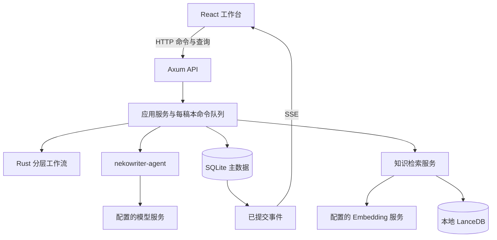

# NekoWriter MVP 实现方案

文档状态：实施基线与进度说明，D01–D16 补充约定已全部由用户确认；实现正在按本文和细则推进。  
最近更新：2026-09-13。
依据：[`NekoWriter.txt`](../NekoWriter.txt)、[`AGENTS.md`](../AGENTS.md)、现有 `webui/`。  
配套文档：[`实现细则`](02-implementation-spec.md)。本文确定产品与架构取舍，细则确定状态、数据、协议和验收行为。

## 1. 结论与产品定位

NekoWriter 应当是一款以小说正文为中心、允许人随时介入的本地 AI 写作工作台。核心体验是：设定目标 → 审核准备产物 → 逐章指导与写作 → 审核定稿 → 完本与番外。

推荐采用 **React 单页前端 + 单进程 Rust 后端 + SQLite 主存储 + 嵌入式 LanceDB**。浏览器承载界面，Rust 进程负责 Agent、状态推进、数据写入及模型请求。前端关闭后任务仍由本地进程管理；进程关闭后不再执行模型调用。

生产级质量在这里体现为正文不误写、意见不丢失、审核不串版、任务中断可解释、数据可导出、界面适合长时间阅读。部署目标是个人电脑，不引入账户体系、多租户、微服务、Redis、消息中间件、容器集群或云端控制平面。

“可扩展”落实到明确的模块边界、带类型的阶段与工具、可替换的模型及能力接口。MVP 不做可视化流程编排器、运行时插件装载器或通用工作流 DSL。

## 2. 当前项目与版本基线

当前工作区已有四 crate Rust workspace（`nekowriter-core`、`nekowriter-agent`、`nekowriter-store`、`nekowriter-app`）、SeaORM 2 / SQLite 存储、LanceDB 烟测、Axum 本地 API 与 React 工作台；现有提交已覆盖初始化 MVP、提示词/跨章浏览、项目设置及后续本地交付能力。后续进度以代码、测试和本文档中的实测记录为准。

前端使用 React 19、TypeScript 6、Vite 8、Tailwind CSS 4、shadcn/Base UI、Lucide 和主题组件。沿用这些依赖及现有 CSS 变量；按实际界面需要添加 shadcn 组件，不整体替换 UI 基础。

截至本次更新，M0 已完成：启动绑定成功后会打开默认浏览器（`--no-browser` 可关闭），日志按天写入数据目录的 `logs/`。M1 的数据模型、状态转换、命令回执、SSE、Chat Completions 兼容适配器、Windows 凭据引用、模型设置与连接测试、准备阶段自动生成、章节细纲自动生成、正文 Agent 的 `append_content` / `replace_content` 循环、人工审核、整章审核和阶段纯文本折叠均已有实现；2026-09-13 已用 InferX `deepseek-v4.1-flash` 在 macOS aarch64 上以 `reasoning_effort=low` 跑通一章从准备到完本的真实全流程（详见实现细则 §15.6）。模型请求按稿本串行、全局并发为 1；准备、细纲和正文的成功回调与产物/工具结果/审核/事件在 SQLite 事务中提交，后续请求按已完成阶段的纯文本 fold 及当前 Run 消息账本构建。

2026-09-13 完成内建提示词升级：10 个用途的 20 个 system/user 文件按准备、细纲、正文及各类审核的实际职责重写，保留现有变量与阶段提交协议；创作约定会随准备产物进入后续上下文，正文提示词强调工具增量编辑、人物与因果连续性，审核提示词按可见依据区分阻断问题和建议。新增阶段质量断言后，工作区测试为 198 个通过；在 macOS aarch64 的 InferX `deepseek-v4.1-flash`、`reasoning_effort=low` 真实流程中完成两章主线和一个番外，三章均审核通过并成功复制、导出（详见实现细则 §15.8）。

M2 已完成的交互闭环包括：正文 `ApproveRequired` 提案及基础修订重验、暂停到工具/提交边界、自由意见批次的原子绑定与投递、直接终态提交的完成守卫、`ask_user` 问答、命令 ID 幂等重试、SSE 游标恢复、进程中断后的显式继续及每次 100 次请求额度续授。完整但不符合阶段协议的模型响应会保留原文和诊断，向同一 Run 追加纠正指令；连续三次才停止，显式继续后才可再次发送。本轮补齐了同一个计数的一处缺口：模型在仍有未投递意见时反复直接提交，原先会把连续协议错误清零而无限重排请求（真实进程实测到 13 次以上仍在继续、计数仍为 0），现在这类「无推进」的纠正计入同一个计数，第三次即把 Run 收束为 `stopped`（`wait_reason = protocol_error_limit`）并保留未投递意见，界面显示停止原因与「显式继续」（实测最多 4 次请求即停止）。用户显式停止会在同一事务中作废 prepared/dispatched attempt，并中止本地在途 HTTP 任务；迟到回调无法再推进工作流。待答问题、待审提案和暂停边界在继续后恢复原状态。界面据停止原因区分额度耗尽、协议错误与用户停止。

正文引用（附件性反馈）已接通：工作台可以把选中的正文或候选文字固定成引用，并随「拒绝并反馈」或自由意见一起提交。正式正文引用锚定在不可变修订上，待审候选引用锚定在工具调用、候选哈希与候选区间上，写入前仍由服务端逐字复核；浏览器 UTF-16 选区偏移在提交前换算为 Unicode scalar 偏移。引用在当前正文变化后显示「来自旧修订」，并可通过 `GET /api/documents/{id}/revisions/{revision}` 只读回看原修订。逐次编辑的接受入口同时改为按「有无文字或引用」决定是接受还是拒绝，不再把填写了反馈却误点接受的操作静默处理。点击委托审核时，当时选中的引用会与反馈文本一起固化为审核子 Run 的输入快照；审核 Agent 只读到引文文本，不接触文档、修订或工具调用 ID。准备、细纲与整章终稿的人工审核决定现在也能携带引用：决定请求与委托共用同一套校验（修订存在、`document_id` 匹配、未删除、属于本稿本、`chapter_id` 一致、范围逐字匹配），校验通过后才把引用和决定写入同一条 Review；准备审核可引用本稿本任意文档，章节审核只能引用本次审核所在章节。

准备产物、章节细纲、逐次正文编辑和整章终稿的审核委托均已接通。委托会创建不带写作工具的审核子 Run，并按审核类型构建独立提示词与受限上下文；合法结论、父工作流推进和阶段折叠在同一事务提交。取消、模型失败或服务重启会使本次 attempt 失效并重新开放 Review；同一成功回调重放只返回已提交快照，不会重复应用决定。

内建提示词的系统级与项目级覆盖已接通：所有权覆盖以 system/user 成对内容保存，有效内容按「项目覆盖 → 系统覆盖 → 代码内建」解析，每个请求都重新解析并把来源写入请求快照；保存前用变量声明的示例值预览，项目作用域由稿本所属项目决定。工作台同时提供章节目录与任意章节的只读浏览，浏览不会发出写作命令。

项目级设置已接通：项目可保存模型引用（模型 ID 与它自己的能力资料）、思考等级与辅助工具预算，与项目实体分开使用独立修订；工作台提供编辑界面，切换项目时旧草稿自然失效。调度器在每次请求取得许可后重新解析有效模型与思考等级，把项目/系统设置修订与预算写入请求快照，并在有效模型未声明支持所需能力（含项目指定了思考等级的情形）时于发请求前报错；能力校验与 HTTP 命令受理前的放行判断共用同一份解析结果，避免校验对象与请求实际发往的模型不一致。辅助工具预算的账本扣减已随 M4 的知识检索落地：准备阶段与每章细纲各有预算作用域，`ask_user` 与正文工具不收费，`query_knowledge` 在执行前扣一次，「无 Embedding」「预算为 0」「参数无效」都不扣费，进入真实检索后失败仍计 1 次。

知识库已接通：Space 与知识条目的 CRUD、软删除与修订、Embedding 配置与连接测试、按 Embedding profile 隔离的索引任务与 LanceDB 向量、段落优先的集中切分参数、先向量近邻再回查 SQLite 的语义检索与同一次检索内翻倍补取，以及显式重建与索引覆盖度均已实现并有真实进程冒烟。辅助工具预算账本同时落地：准备阶段与每章细纲各有作用域，只记录已用数，有效上限每次执行前从项目最新设置读取；收费工具以 `(scope_id, tool_call_id)` 唯一键登记，同一次调用重放不重复扣除，余额为 0 时不登记并返回 `QUOTA_EXHAUSTED`。研究/积累的接口合同与编译期注册表已就绪，生产注册项严格为 0：能力查询返回空数组与原因，积累入口返回 `ENGINE_NOT_AVAILABLE`，不建任务、不写条目、不扣预算。积累引擎的成功写入路径也已经按 §7.4 实现：它是应用服务里的一条普通写入命令——先查命令回执（重放不再次调用引擎），再校验线索与目标 Space，再取本次进程的积累引擎注册表；引擎返回候选条目后在 Store 边界逐条验证，并在同一事务里插入条目、建立索引任务与写入回执。引擎不可用返回 409、引擎失败返回 502 且什么都不写、候选无效整批不写、同一 `command_id` 换一组线索返回幂等冲突。生产注册表仍为空，因此运行中的应用永远不会写到这条路径上——它要等第一个真实引擎，本轮以测试内注册表在真实端口上的真实 HTTP 走通了完整回路（见 docs/03 §19）。Embedding 的 Token 用量也已落库：索引、检索与连接测试（含保存设置前的验证调用）的每一次向量 HTTP 请求都在 `system_model_operations` 里各占一行，带上 `usage_source = embeddings_http` 与 `usage_status`，供应商没有报告时记为未知并保留原因；概览把 Embedding 输入用量单独列示（并按操作类型拆分），既不混进对话 Token 总数，也不重复计入系统操作。准备与细纲 Agent 因此在 Embedding 可用、索引有可检索条目且仍有余额时才会拿到 `query_knowledge` 工具，工具描述带上剩余余额。

模板模块与 Dashboard 已接通：受限模板语言（一次性 `{{variable_name}}` 替换、`\{{...}}` 字面量转义）只在 `nekowriter-core::template` 实现一次，内建提示词覆盖与用户模板共用同一份扫描、校验与渲染，因此未知变量、不完整括号与必需占位符规则不会分叉。用户模板以标题、正文与自定义变量声明为独立内容保存（`prompt_templates` 表，软删除，`command_id` 幂等与 `expected_revision` 乐观并发），保存与修改都在 Store 边界重新校验，`POST /api/prompts/preview` 用同一路由同时服务内建草稿与用户模板（缺省值回落到示例值），工作台可把渲染结果插入章节指导或意见草稿。Dashboard 不保存任何累计值：`GET /api/dashboard` 每次从已封存模型请求的 `usage_json`（按写作/审核角色与本地日分桶，缓存命中与思考用量标为子集，没报告用量的请求单列「用量未知」）、`runs` 行与工作流当前执行轴（排队、模型运行、等待用户、等待审核、已暂停分区，中断与失败进入需处理，审核子 Run 展开显示）和 `document_revisions` 修订链（相邻修订非空白字符数之差，复制稿本计 0）回算，时区由调用方给出的偏移换算成 UTC 左闭右开区间，日期分桶在查询层完成。

用量口径也已经收口：每条已封存请求的 `usage_json` 都是一份 `PersistedModelUsage`，`usage_source` 说明数字来自哪里、`usage_status` 说明是否真的拿到了报告（`reported` / `unknown` / `invalid`），供应商原始字段保存在 `raw` 内；没有报告的请求写缺失字段并带上类型化原因（`provider_silent` / `request_failed` / `request_cancelled` / `pending` / `invalid_report`），因此「用量未知」能说明自己。适配器的 `ModelCompletion::persisted_usage()` 是这两个字段的唯一写入点，Dashboard 反过来反序列化同一个类型，字段名不可能静默分叉。连接测试这类不属于任何稿本的请求写入 `system_model_operations` 表（schema 25）并在概览里单列为系统操作，既不混进对话 Token 也不会凭空消失。工作台概览不再等用户点刷新：任何持久事件（`run.changed` / `document.committed` / `review.changed` / `feedback.changed` / `system.model_operation` 等）都会触发一次重算，模板列表同理跟着 `prompt_template.changed` 刷新。

正文导出也已接通：`GET /api/versions/{id}/export?format=md|txt` 每次在同一个读取事务里从 `documents` / `document_revisions` 的已提交修订链现读，没有另存副本也没有缓存；正文按计划顺序在前、番外按自身序号在后，标题用与工作台目录一致的 `第N章 标题` / `番外 N 标题` 写法。只有「当前修订就是通过整章审核的那一份」才算定稿，已通过但之后又被编辑过的章节与尚未通过的章节一样标为 `（草稿）`；文件名由小说标题消毒而来（去除路径分隔符、控制字符与连续点号），响应头同时给出 ASCII 回退名与 RFC 5987 的 `filename*=UTF-8''…`。稿本不存在返回 404，`format` 缺失或不是 `md`/`txt` 返回 422，一个章节都没有的稿本仍导出一份写明「本稿本还没有章节」的标题文件。工作台「稿本」面板提供 Markdown 与纯文本两个入口。

长篇阅读也已接通：工作台的「阅读」视图把整部作品放在一个连续滚动区里按章虚拟化，只有视口附近的章节被挂载、正文按窗口向后端索取（默认 20 章），因此打开成本只与视口有关；目录同样是虚拟列表，以章节 id 作 key。章节顺序与显示名由 `nekowriter-core::manuscript` 唯一决定（正文在前、番外按自身次序编号），目录、阅读窗口与导出不会给出三种答案。定位先按虚拟下标滚动、再在正文加载与高度测得后校正到目标块顶对齐视口顶，不使用未挂载 DOM 的 `scrollIntoView()`；阅读位置以「章 + 块内偏移」记在浏览器本地存储，切换视图、切换面板与重新加载页面后回到原处，字号变化会重新测量并把当前章对齐到顶部。整稿查找由服务端读遍全部已提交正文（与导出同一份快照），返回与引用同一单位（Unicode scalar、左闭右开）的偏移并直接高亮——浏览器自带的页内查找只能看到已挂载的章节，这是窗口化的必然代价。

主题与键盘体验也已接通：原来绑定在单键 `d` 上的全局主题切换监听被删掉（它会在阅读与文本操作里误触），主题改为工作台头部的浅色/深色/跟随系统三段选择器，选择仍由 `ThemeProvider` 存在浏览器本地与 `${storageKey}` 里。快捷键集中在 `webui/src/lib/shortcuts.tsx` 一处：`Ctrl/Cmd+Enter` 提交当前表单（光标在输入框里时提交该表单的 `type=submit` 主操作；不在输入框里且全场只有一个可用阶段主操作时触发它）、`Ctrl/Cmd+K` 聚焦整稿查找框、`Esc` 关闭最上层可安全取消的层、`?` 开关快捷键说明；说明由头部按钮与 `?` 打开，列出的就是这几条。组合输入只认「可编辑目标上的 compositionstart」，并用 `isComposing` 与 `keyCode === 229` 判定，因此一个没有配对的 compositionstart 不会把整个键盘关掉（窗口失焦也会清除状态）；确认候选词的那次 Enter 在 document 捕获阶段拦下随后的 `submit`，且必须 `preventDefault` 与 `stopPropagation` 同时生效——表单由 React 接管，只 `preventDefault` 仍会执行 `onSubmit` 并发出请求（这是探针实测出来的缺陷，不是推断）。审核通过/退回、停止执行、退出服务不绑定任何快捷键。

退出流程与本地交付也已接通：`nekowriter-app::lifecycle::Shutdown` 是唯一的退出信号，Ctrl+C、SIGTERM 与 `POST /api/system/shutdown` 三条触发都汇到它，并且必须写进同一个信号——否则用户按 Ctrl+C 时已经打开的 SSE 连接看不到「已请求退出」，优雅退出会一直等持久连接断开。接口退出先把 `{"status":"shutting_down"}` 写回客户端再触发收尾。顺序是：服务器停止接受新连接 → 取消在途模型请求（abort 后最多等 5 秒）→ 在同一批事务里把活跃 Run 收束为 `interrupted`、在途请求标为 `cancelled` / `unknown` 并广播 `reason=process_shutdown` → `PRAGMA wal_checkpoint(TRUNCATE)` 把 WAL 落回主库文件并关闭连接池 → 进程退出。启动恢复与退出收尾共用同一条 `Store::interrupt_active_runs` 路径，只有事件原因与用户可见文案不同。日志随启动落到数据目录的 `logs/nekowriter.<日期>.log`，按天滚动、只保留最近 7 个文件；启动绑定成功后用系统默认浏览器打开工作台（`--no-browser` 关闭该行为）。前端资源按「可执行文件旁的 `webui/dist`」解析（`--web-dir` 可覆盖），因此发行目录整体拷走、从任何工作目录启动都能打开界面。`cargo xtask package [--target <三元组>]` 组装同一种形状的发行目录：`nekowriter(.exe)` + `webui/dist` + `README.txt` + `release-manifest.txt`（目标三元组、构建配置、可执行文件容器格式与逐个文件的字节数 / SHA-256）；缺省按本机三元组打包，打包时会读头部确认可执行文件真的是该平台的容器格式，拷错或改名一个别的平台的二进制会直接失败。工作台「本地服务」面板显示界面地址、实际数据目录、退出按钮与重新启动说明；服务退出后界面显示「本地服务已退出」而不再只显示正在重连。

回收站恢复也已接通：删除是软删除，`GET /api/recycle-bin` 按删除时间倒序列出项目、稿本、番外章、用户模板、知识条目与空 Space，每条都带上「现在能不能恢复 / 能不能彻底删除」的结论与原因；恢复只把 `deleted_at` 清回去，因此正文、修订 id 与在作品里的顺序都还是原来那一份，不会为了「恢复」再写一条新修订。删除一个项目（`DELETE /api/projects/{id}`）只标记项目本身，不批量改写它下面任何孩子的状态：查询逐层检查祖先，所以项目在回收站里时它的稿本、章节与正文都不可见，而恢复项目会把它们原样带回来，删除项目之前单独删掉的稿本仍留在回收站里（不会因为恢复项目而被误恢复）；项目下仍有开放审核或活跃写作任务时返回 `RESOURCE_BUSY`。番外章的删除与恢复走 `DELETE /api/chapters/{id}` 与回收站恢复接口：删除会在同一事务里把工作流从那一章收回到仍然可见的最后一章，恢复则只恢复数据与位置，不把写作光标搬回去（用户可能在删除之后已经在别处继续写）。恢复一份稿本要求它的项目仍然可见；父对象仍在回收站里、或对象已经被彻底删除时明确报错（`RECYCLE_ANCESTOR_DELETED` / 404），不做半恢复。项目、稿本与正文为保留审计链只留在回收站里，彻底删除会被拒绝（`RECYCLE_NOT_PURGEABLE`），可物理删除的模板与知识对象则提供「彻底删除」路径且删除后不可恢复。工作台新增「回收站」面板：显示类别、标题、删除时间与原属稿本，面板订阅 `recycle.changed` 事件自动更新，恢复/彻底删除成功后同时重读项目列表与章节目录；「番外」面板列出已有番外并提供带二次确认的删除入口，稿本列表对非当前稿本提供同样的删除入口（当前选中的稿本要先切走）。

尚未完成的边界必须保持明确：

- M4 已全部完成（知识库与索引、预算、零引擎能力与积累写入路径、模板、Dashboard 与 §12.1 的用量口径）。积累引擎的成功写入路径已实现并有端到端验证，但生产注册项按 §3.3 与细则 §7.4 严格为 0，所以运行中的应用不会产生任何积累写入；这条路径要等第一个真实引擎才会被走到，不是遗漏。
- M5 剩余——非 macOS 平台的发行产物（长篇阅读、主题与键盘/中文输入体验、回收站恢复、导出、退出流程、全平台发行目录与发行清单均已完成，macOS 的 `--release` 产物已真实产出并在仓库之外跑完“写正文 → 退出 → 重启 → 信号退出”的回路；Windows x64 的 PE 产物与其它平台产物本机无法产出（`rustup target list --installed` 只有 `aarch64-apple-darwin`，没有对应目标的链接器与标准库），配方与 CI 步骤已写进细则 §11.5，M5 的复选框因此仍未整项勾选；本轮按用户决定只做 aarch64-darwin：发行包按当前代码重建并独立核对（13 个文件逐项 SHA-256、Mach-O `0x0100000C` 头、`index.html` 引用的资源都在包内），打包器「容器与架构都要对」的硬检查用一个**真实的 x86_64 Mach-O** 走过反例——旧发行目录逐字节未动、失败后没有留下空壳，未安装标准库的目标在**任何构建之前**失败且不改写 `webui/dist`）。
- M1 的真实模型连接测试与一章最小真实创作闭环已用 InferX `deepseek-v4.1-flash` 在 macOS aarch64 上通过；M3 随后以同一真实模型完成两章主线、一个番外、稿本复制、Markdown/TXT 导出及完本确认。M2 的 §15.2 A/E/F/R 组全部可达用例已由回归覆盖，真实浏览器已复核 SSE 连通、稿本与项目切换、阅读与搜索、中文组合输入、导出、项目设置保存及设置隔离。E06、R05 在公开状态机中不可构造，防御性校验仍保留；D09 的 `preview.delta` 另有进程内 HTTP/SSE 集成测试覆盖。
- 意见投递的当前状态已可见：正文快照把当前 Run 最近一个尚未成功响应的请求所携带意见单列为 `deliveredFeedback`，Dock 显示「已随请求发送，等待模型回应」或「请求失败，尚无模型回应」（也会明确未知与取消）。请求成功后不把历史意见长期留在当前 Dock；原始意见、工具消息和请求快照仍可从持久记录追溯。
- 三项长期边界——从引用跳回当前正文位置、仅引用而无文字的自由意见、Dock 草稿的浏览器本地持久化。
- 上一轮留下的三个可见缺口——概览的事件订阅依赖选中稿本的游标（没有任何项目时系统操作要等下一次事件或手动刷新）、`TemplateInserter` 的实时刷新只在模板列表这一条路径上被真实界面验证过、概览仍是「读进内存再汇总」而不是 SQL 聚合。其中最后一条已部分收口：字数统计不再把修订正文读进内存（只取六个统计列，并在 SQL 里排除不可见文档的修订），Token 与系统操作仍然是区间内读行到内存再汇总——在 20 万行的极端数据上 90 天查询是秒级，真实库量级下是个位数毫秒，因此有意没有加保留策略或预聚合。
- 导出本身的两个已知边界——番外顺序只有 store 层用例覆盖（真实进程探针没造出番外）、导出不落任何服务端文件因而没有导出历史或后台打包。
- 长篇阅读的三个已知边界——章节高度在未挂载时是按字数估计的（实测估计值与真实高度差约 12%），滚动条长度在整部作品被测量过之前是近似的；阅读位置是浏览器本地状态，换浏览器或清空存储后回到第一章；工作台的写作视图与阅读视图是并列视图，方案 §6 的顶部主导航与「项目卡片 → 概览跳转」仍是 M5 的界面收尾。
- 退出与交付的已知边界——「服务已退出」之后的界面状态只有静态检查（预览桥在服务进程结束后不再连接，因此没有在真实界面里截到退出后的那一次渲染）；`--release` 产物已在 macOS 上真实产出并验收（发行目录与清单、仓库之外启动、`lsof` 确认不依赖源码树、写出一章 72 字正文、接口退出与 SIGTERM 两条路径都在 0.3 秒内退出码 0、重启后数据与 `interrupted` 状态一致），但 Windows x64 的 PE 产物本机环境无法产出（没有 Windows 目标的链接器与标准库），其它平台也只验证了「同一条命令可用」而没有实跑；release 产物未做符号裁剪（262.6MB，`strip -x` 可降到 205MB）；数据目录仍是单一全局目录，没有「切换作品库」的入口。本轮把这条回路在重建后的 aarch64 release 发行包上又跑了一遍（仓库之外启动、真实 API 写出 72 字正文、接口退出 0.2 秒与 SIGTERM 0.1 秒都以退出码 0 结束、重启后数据与 `interrupted` 状态一致），产物与清单由独立脚本逐行重算通过。
- 键盘与中文输入验证的是真实浏览器里的真实事件序列（`compositionstart`、带 `isComposing` 与 `keyCode 229` 的 `keydown`、`compositionend`、合成的隐式 `submit`），不是操作系统里实际的输入法候选窗；macOS 以外平台的输入法行为未经真实验收。`Ctrl/Cmd+Enter` 的「唯一阶段主操作」分支目前只登记了准备阶段的「开始准备」与恢复面板的「显式继续」，两者同时可用时会因为不唯一而不触发；主题选择器只有浅色/深色/跟随系统三种，没有独立的全局设置页。
- 回收站的两个已知边界——恢复不把写作光标搬回被恢复的那一章（删除时工作流已经收回，用户需要点一下目录）；删除没有「归档」或批量整理入口，也不能一次删多个对象。

macOS aarch64 的用户验收范围现已完成；全平台计划仍不能因本机闭环而标记为全部完成，因为非 macOS 发行产物尚未实际构建和验收。

### 2.1 当前进度快照

按 §8 里程碑加权估算，macOS aarch64 用户验收范围为 100%；若按所有平台的原计划计算约为 99.8%：M0、M1、M2、M3、M4 均为 100%，M5 为 98%。M5 的余量只包括尚未在目标环境构建和验收的非 macOS 发行产物；正文导出、长篇阅读、主题与键盘/中文输入体验、回收站恢复（含项目级）、退出流程、全平台发行目录与发行清单，以及 macOS `--release` 产物均已完成。

截至 2026-09-13，`cargo test --workspace` 共 202 个测试通过（agent 39、app 47、core 38、store 74、xtask 4）；`cargo fmt --all -- --check` 与前端 `tsc -b && vite build` 通过。M2/M3 的当前验收证据与逐项映射见实现细则 §15.7–§15.8，代码审查汇总见 docs/03 §33。

审计在真实进程里实测的两个 Embedding 缺陷已经修掉：用量字段改为宽容解析（供应商写字符串数字、裸数字、`null`、空数组、缺字段都不影响向量成败，读不出计数就按型别化未知原因记录），保存配置前的真实验证调用移到准入检查之后（修订过期、字段无效、同一命令重放都不再花掉一次真实请求，只有真正会写入的保存才调用供应商并落库）。

紧接着补齐了 §12.1 的三个镜头：Embedding 进入角色拆分与按日序列（同一批数字的另外两种镜头，不是新计数，对话总量与对话日序列不变），归属用 `tokens.embedding.scope` 写在响应里；系统模型调用的落库从两份逐行同构的实现合并成 `nekowriter-app::operations` 一条写入路径。

随后一轮审计在真实进程里量出一个主流程资源缺陷并已修掉：概览的字数统计为了计数把 `document_revisions` 的正文与结构化载荷一并读进内存（6,000 条修订、正文 4,000 字符时 RSS 从 40MB 涨到 192MB 且不回落，耗时 25 → 105ms 且与查询区间无关）。现在这条查询只取六个统计列（`id` / `document_id` / `revision_no` / `word_count` / `created_by` / `created_at`），并在 SQL 里排除已删除文档与非正文文档的修订。同一轮审计还发现打包器的头部校验只比容器家族、不比架构（`aarch64-unknown-linux-gnu` 配一个 x86-64 的 ELF 会被当成正确产物），也已补上：容器与架构都要与三元组一致，缺标准库的目标在任何构建之前就以 `rustup target add` 结束（不再先白构建一次 `webui/dist`），后端编译也移到前端构建之前。

随后一轮发行包敌意试玩（真实 `target/package/aarch64-apple-darwin/nekowriter` + 本地打桩模型，桩只用于驱动流程、不当真实模型验收）在界面里跑通了「建项目 → 目标 → 准备四产物审核 → 细纲审核 → 正文工具调用与终稿 → 阅读视图与查找 → 回收站删除/恢复/彻底删除 → 概览 → 服务面板」整条回路，并暴露三个真实缺陷，已就地修掉：

- 阶段角色的 system 消息里从未包含本阶段的提交结构，章节级提交所需的 `chapter_id` 更是模型无法推断的值。真实进程抓到的准备阶段请求体只有 127 字符的提示词、111 字符的 user 消息与 `response_format: {"type":"json_object"}`，既没有字段名也没有章节 ID，因此准备/细纲/正文提交在真实模型下不可能成立（违反细则 §4.1「阶段角色只包含…提交结构」）。现在 `nekowriter_agent::runner::submission_contract` 与解析器同源生成合同文本（章节级带具体 `chapter_id`），`stage_system_instructions` 把它接到准备、细纲、正文、审核四个阶段的系统消息上；单元测试盯住每个字段，两条 lane 测试直接断言发给假服务的 HTTP 请求体里带着 `chapter_id` 与本章 ID。
- 删除用户提示词模板只发 `prompt_template.changed`，删除知识 Space/条目两个接口都不发 `recycle.changed`，于是已打开的回收站页面停在「回收站是空的」直到手动刷新（违反细则 §10.3「每次删除、恢复与彻底删除都在同一事务里写一条 `recycle.changed`」）。实测：API 已返回被删模板而界面仍显示空回收站，点一次「刷新」才出现。三处写入补齐事件后，删除与恢复都会即时刷新。
- 凭据错误消息与模型设置说明把凭据库写死成「Windows 凭据管理器」，在 macOS 发行包上会给出与本机无关的提示，已改为平台中立措辞（错误消息同时给出 Windows 凭据管理器与 macOS 钥匙串）。

本轮也是「概览无需手动刷新」这条既有能力的真实界面复核：第一章定稿后，未点任何刷新，「等待审核」由 1 变 0、「正文净字数」由 0 变 7。

随后又用最敌意的方式把「提交结构是否足够」证死。先找本机可用的本地模型运行时：`ollama` / `llama-cli` / `llama-server` / `lms` / `mlx_lm.generate` / `text-generation-launcher` / `vllm` / `koboldcpp` 都不在 PATH，没有 Ollama/LM Studio 应用与数据目录，没有任何 `.gguf`/`.safetensors` 权重，也没有 `transformers`/`torch`/docker，常见本地端口无人监听——**这台机器上不存在可用的本地模型运行时**，所以真实权重的 M1/M3 验收依然完不成，写进 docs/02 §16 作为环境边界。

于是换成「只懂合同」的朴素桩（`/tmp/nw-naive-contract-stub.py`）来验证合同本身是否充分：它不认识任何阶段名或字段名，只把系统消息里括号配对取出的 JSON 骨架当成提交模板（含中文说明或 `…` 的字符串替换为生成文本，纯 ASCII 的枚举与 UUID 原样保留），工具调用只挑「合同正文提到且本次请求声明」的工具、并按该工具自己的 JSON Schema 造参数。在真实进程上跑完整回路（准备四项 → 细纲 → 正文工具调用 → 终稿）得到第 1 章 `approved`，推导日志逐条记录每个键是「保留」还是「按合同填充」，`chapter_id` 直接取自合同里的 UUID。反例：只把章节级骨架里的 `chapter_id` 改写成 `chapterId` 并重建同一份代码，同一回路在细纲阶段连续三次协议错误、Run 以 `waitReason = protocol_error_limit` 停在 `writing_outline_generating`（准备阶段合同未改，照常通过）；改回后同一回路再次走到 `approved`。两轮实验用的都是真实进程与真实阶段流转，但结论仍然**只适用于桩**：它证明的是合同文本足以推导出合法提交、且修复落在正确位置，不等于真实模型验收。

支路重跑之后，状态已经收到可交付：当前源码 `cargo test --workspace` 190 通过（含新增的不推进提交上限断言），`cargo fmt --all -- --check` 干净；`cargo xtask package --release` 从这一份源码重建了 `aarch64-apple-darwin` 发行包，独立脚本重算 13 行清单（字节数与 SHA-256）、核对 Mach-O 头部与 `index.html` 引用的资源，0 个问题（可执行文件 262,589,360 字节、cputype `0x0100000C`，二进制 SHA-256 与修复前不同，符合源码已变的事实）。完整回路与两条相关路径都在**这个重建产物**上重跑：建项目 → 四项准备产物审核 → 细纲审核 → 正文工具调用与整章终稿 `approved` → 阅读视图与整稿查找（「找到 1 处」）→ 回收站（模板删除 → 自动出现 → 恢复 → 再删除 → 二次确认彻底删除，之后恢复与彻底删除该 id 都返回 404）→ 概览（项目口径 输入 200 / 输出 100 / 请求 4 / 用量未知 0、角色 `writing`、按日 9/13 为 300 token，与库内 `model_requests.usage_json` 逐项一致；正文净字数 14 与本章正文修订的 `word_count` 一致）→ 本地服务面板 → 界面退出。两条路径：反复不推进的章级提交在第 4 次请求后 `stopped` / `wait_reason = protocol_error_limit`、计数 3、未投递意见仍为 `queued`（不再无限重排）；意见在能投递时走 `queued → included`、确实进入下一次请求（`feedback` 行 `included`、绑定请求 id 命中请求快照）并把工作流推进到 `writing_chapter_reviewing`。界面退出后进程 0.2 秒内以退出码 0 结束、日志写入「已退出」、`-wal` 消失，桩进程与全部监听端口一并清干净。模型仍是桩：以上全部结论**只来自桩**（`/tmp/nw-branch-stub.py`），真实模型验收仍未完成。
随后按细则 §15.2 把竞态矩阵在真实进程 + 桩模型上逐行重跑（桩不是真实模型，结论只适用于桩）。A/E/R/F 四组共 24 条记录落在 `matrix-results.json`，逐行状态轨迹与库内行一致：A01–A03、E01–E05、E07、R01–R04、F01–F04、F06、F08–F10 通过，E06 与 R05 记录为真实接口无法构造。本轮因此修掉一个真缺陷：适配器原先把「一次响应给出多个工具调用」当成传输失败，整个请求以 `provider_error` 结束（真实进程实测该 Run 直接 failed、`tool_calls` 零行），现在适配器只负责完整还原响应里的每个调用，「一轮只允许一个」由阶段守卫的 `ParallelToolCalls` 单独判定，调度器再为整批每个调用 ID 写入配对的 `PARALLEL_TOOL_CALLS_NOT_ALLOWED` 结果并给出串行纠正；同时协议纠正消息带上了本次校验失败的具体原因（此前只给通用提示，模型看不到缺的是哪一项）。前端重连也在真实浏览器里单独验过：快照水位之后开流能收到真实写入产生的事件、用 `Last-Event-ID` 重连只推水位之后的事件且不重放、非法游标返回 400 `INVALID_EVENT_CURSOR`、超出水位返回 `reset_required`。矩阵当时暴露的四个缺口已在随后一轮收口，细则 §15.4 记录了实现与回归范围。

2026-09-13 的后续收口覆盖这四项：工具结果的参数/协议错误现在与提交协议错误共享 Run 的三次上限，第三次会以 `protocol_error_limit` 停止，成功执行会清零；准备修订合同只列出当前需要修订的产物，并有研究项与粗纲项的回归断言；暂停期间无法应用的直接正文提交不再让 `resume` 返回 422 并永久停住，而是保留模型原文、追加纠正指令、清除暂存提交并重新排队；`preview.delta` 已从模型流接到独立的临时 SSE 层和工作台预览面板。预览含稿本、请求、工具槽位和 Unicode scalar 偏移，没有 SSE `id`，持久请求事件、断线或切换稿本都会丢弃对应缓冲，因而不会把半截文本写进任何修订。六个新增自动化用例覆盖三次停止、修订合同、可恢复的暂停提交与无 id 的 SSE 预览事件。随后正文 Dock 又补上投递可见性：已封存意见随当前未成功请求的状态单列展示，覆盖发送中与失败状态，避免意见离开队列后没有去向说明。

| 项目 | 实施选择 | 依据与限制 |
| --- | --- | --- |
| Web 服务 | Axum + Tokio + tower-http | 官方文档提供 SSE 支持，适合单向生成事件推送；查阅版本为 0.8.9。[Axum SSE](https://docs.rs/axum/latest/axum/response/sse/) |
| 关系存储 | SeaORM + SQLite | CRUD 与事务由 SeaORM 实现；查阅版本为 2.0.2。[SeaORM](https://docs.rs/sea-orm/latest/sea_orm/)、[事务文档](https://www.sea-ql.org/SeaORM/docs/advanced-query/transaction/) |
| 向量存储 | LanceDB Rust SDK，本地目录 | 进程内运行，无需额外数据库服务；查阅版本为 0.38.0。[LanceDB Rust](https://docs.rs/lancedb/latest/lancedb/) |
| 服务端状态缓存 | TanStack Query | 管理查询、刷新和请求状态；业务状态以服务端快照为准。[官方说明](https://tanstack.com/query/latest/docs/framework/react/overview) |
| 前端交互状态 | XState | 显式描述分层状态及连接状态等并行区域。[并行状态](https://stately.ai/docs/parallel-states) |
| 长篇阅读 | TanStack Virtual | 按章节虚拟化，保留页面与样式控制权。[官方说明](https://tanstack.com/virtual/latest/docs/introduction) |
| 路由与校验 | React Router；Rust serde + 类型化校验 | 前端只用客户端路由，不引入另一套全栈框架。[声明式路由](https://reactrouter.com/start/declarative/installation) |
| 密钥 | Windows 凭据存储 | Rust 采用 keyring 生态的对应平台存储；具体 API 随锁定版本核验。[当前 keyring 使用说明](https://docs.rs/keyring/latest/keyring/) |

这些版本是查阅时的文档快照，不是已完成的联合构建结果。需求中的 `@latest` 解释为实施起点选择最新稳定版、排除预发布，再提交 `Cargo.lock` 与前端锁文件；不使用浮动 `*`。第一阶段必须验证 Windows 上的 Rust 工具链、LanceDB/Arrow 依赖及前端构建组合，之后按锁文件重现。

## 3. MVP 范围与需求补全

### 3.1 必须交付

| 模块 | MVP 内容 |
| --- | --- |
| Dashboard | Token 使用、进行中任务、正文净字数增量；支持时间范围与项目筛选 |
| 项目 | 创建、重命名、项目设置、小说标题、小说版本、软删除与恢复 |
| 准备阶段 | 背景设定、资料收集、人物设定、小说粗纲；询问用户；四项齐备后集中审核 |
| 正文阶段 | 章节指导、细纲及审核、正文工具编辑、逐次审核/自动接受切换、暂停与意见队列、整章审核 |
| 审核委托 | 准备产物、细纲、每次正文编辑、整章审核均可委托；不同审核使用不同提示词 |
| 阶段上下文折叠 | 当前阶段全部必需产物审核通过后，其历史消息统一折叠为仅含完整产物内容的纯文本，供后续请求使用 |
| 工作台 | 章节导航、连续正文阅读、实时更新、编辑差异高亮、引用、上下文 Dock |
| 提示词 | 内建 system/user 成对条目、系统修改、项目覆盖、变量说明、独立用户模板 |
| 知识库 | Space、知识 CRUD、手动录入、向量检索、索引状态、知识积累接口与空注册表 |
| 能力基础设施 | 联网研究接口与空注册表；MVP 不实现任何研究或知识积累引擎 |
| 本地可用性 | 本地启动、持久化、显式恢复中断任务、正文 Markdown/TXT 导出、基础诊断 |

最后一行中的导出和中断处理是本地实用工具的工程补全项，不是原文逐字要求。

### 3.2 已确认的补充约定（D01–D16）

用户已确认下列 16 项补充约定全部采用本方案决策。它们作为正式需求与实施约束，后续实现直接执行，无需再次逐项确认。其中 D16 采用已纳入“审核通过后阶段历史折叠为产物纯文本”需求后的决策。后续修改这些决定时，应同步修改需求、细则和验收用例。

| 编号 | 原需求问题 | 已确认决策 |
| --- | --- | --- |
| D01 | “细纲撰写完成后交由”未写完 | 交给用户审核，可委托审核 Agent；通过后才进入正文 |
| D02 | 四个准备 Tab 被称为“四个阶段” | 解释为同一准备阶段的四类产物；全部提交后进入统一审核界面 |
| D03 | 小说版本的含义 | 版本是一份独立稿本；项目包含多个稿本，每个稿本有自己的设定、粗纲、章节和工作流 |
| D04 | 字数与 Token 的关系 | 中文写作字数采用不含 Unicode 空白的字符数，标点计入；Token 单独统计 |
| D05 | 何时开始下一章、何时完本 | 粗纲提交有序章节计划；每章通过后停在下一章指导；计划内全部章节通过后由用户确认完本 |
| D06 | 辅助工具预算范围 | 准备阶段一个预算作用域、每章细纲一个预算作用域；修订沿用同一作用域；正文工具免费 |
| D07 | 委托审核是否消耗辅助预算 | 不消耗辅助工具 quota，消耗模型 Token；委托只覆盖本次审核，不自动授权以后审核 |
| D08 | 置信度是否控制通过 | `passed` 决定审核结果，置信度只展示；不擅自加入通过阈值 |
| D09 | “暂停前最近一个 toolcall 返回值” | 指尚未进入下一次模型请求的最近返回值；已发出的请求及历史消息不可原地改写 |
| D10 | 向量由谁生成 | 增加显式 Embedding 配置和一个可用适配器；没有配置时语义检索不可用，手动知识管理仍可使用 |
| D11 | 准备资料依赖联网，但研究引擎实现数为 0 | 如实记录资料来源与缺口，可询问用户；不生成虚构链接或假装已联网 |
| D12 | 基础模型接入 | MVP 交付 Chat Completions 兼容协议适配器，用户填写地址、模型和密钥；不绑定具体模型品牌 |
| D13 | 完本后的番外 | 番外复用章节流程，单独编号；正文完本标记保留，允许多次新增番外 |
| D14 | 切换到自动接受时已有待审编辑 | 模式立即生效，但已有提案仍需明确决定；自动接受适用于后续新编辑 |
| D15 | 正文开始后修改设定或粗纲 | 当前稿本锁定准备产物与计划；需要改变时创建新空稿本，MVP 不自动追溯重写 |
| D16 | 长篇上下文超过模型窗口 | 阶段通过后按新增需求保留产物全文、折叠过程消息；仍超出窗口时明确报错，不自动摘要或裁剪产物 |

“本地工具”表示服务和数据在本地，不等于模型离线。使用远程模型或远程 Embedding 时，相应输入会发送到所配置服务；设置页明确显示服务地址与用途。

### 3.3 明确延后

多人协作、在线账户、云同步、实时协同编辑、全功能富文本编辑器、Git 式分支合并、自动发布、PDF/EPUB 排版、通用工作流编辑器、多种模型协议、具体联网研究引擎、具体知识积累引擎均不进入本次 MVP。

用户直接手改正文也不进入 MVP；正文操作通过指导、意见和 Agent 编辑完成。这可以让首次交付集中验证需求明确要求的审核编辑协议。

## 4. 整体架构



### 4.1 四个 crate 足够

```text
nekowriter/
├── Cargo.toml
├── Cargo.lock
├── rust-toolchain.toml
├── crates/
│   ├── nekowriter-core/       # 领域类型、分层状态、守卫、纯决策函数
│   ├── nekowriter-agent/      # AgentLoop、模型协议、工具描述、上下文、内建提示词
│   │   └── prompts/          # include_str! 嵌入的 Markdown
│   ├── nekowriter-store/      # SeaORM、SQLite 建表、LanceDB、查询及事务
│   └── nekowriter-app/        # 可执行程序、Axum、应用服务、任务调度、能力实现
├── webui/
│   └── src/
│       ├── app/              # 路由、Providers、应用壳
│       ├── features/         # dashboard/projects/workbench/prompts/knowledge/settings
│       ├── components/ui/    # 延用 shadcn/Base UI
│       └── lib/              # HTTP、SSE、生成的 API 类型、工具函数
└── docs/
```

依赖方向：`app → core/agent/store`，`agent → core`，`store → core`，`core` 不依赖另外三个 crate。Core 不引用 Axum、SeaORM、React，也不进行 I/O。App 组合具体存储与 Agent，不为每张表创建一层抽象仓库接口。

仅对确实存在替换需求的边界定义 trait：模型协议、Embedding、联网研究、知识积累，以及 Agent 调用应用工具的 `ToolHost`。流程阶段先使用 Rust enum 与具体处理函数；新增阶段需要改代码、状态转换及测试，无需数据库配置一种编程语言。

### 4.2 状态与执行

服务端工作流是唯一业务事实来源。前端 XState 管理快照呈现、Dock 交互、命令提交和连接状态，不独立判定审核通过或下一阶段。

后端使用两条独立状态轴：

- 工作流轴：初始化 → 准备 → 逐章写作 → 完本 → 可选番外；准备和写作内部各有子状态。
- 执行轴：就绪、请求中、工具边界、等待回答、等待审核、已暂停、已中断、失败。

暂停请求与审核模式是显式控制数据，不通过十几个互相冲突的布尔值拼装页面。工作流保存稿本和阶段，执行状态保存当前请求、工具调用和恢复位置。完整转换规则见细则 §3–§6。

同一稿本的写作命令串行处理，同一项目只运行一份稿本的写作流程；不同项目可排队。MVP 全局最多执行一个模型网络请求，写作与委托审核共用这个调度器；父任务等待审核时释放执行许可，避免子任务死锁。等待用户的任务不占用模型请求许可。

### 4.3 存储分工

SQLite 保存所有不可丢失的业务数据：稿本、正文、不可变修订、审核、意见、任务、工具调用、请求设置快照和统计记录。LanceDB 只保存可由知识正文重新生成的检索数据，不存唯一一份小说正文。

SQLite 与 LanceDB 不共享事务。知识写入先提交 SQLite 的内容修订和索引任务，再由本地任务执行器更新 LanceDB。检索结果须回查 SQLite，过滤已删除条目及过期修订。索引失败必须显示原因和明确的重建操作。

知识检索的 `top_k` 指最终有效结果数。候选过滤后不足时，在同一次检索内继续补取，直到取得足够结果或候选耗尽；补取复用查询向量，不重复扣辅助工具预算。

SQLite 启用 WAL、外键和短事务；WAL 的检查点与文件行为须遵循官方约束。[SQLite WAL](https://www.sqlite.org/wal.html) 模型请求、等待用户以及向量计算均在数据库事务之外。

首次初始化以 `nekowriter-store::entity` 的 SeaORM Entity 注册表为 schema 权威，使用 `SchemaBuilder::apply` 创建表、列、普通唯一键和外键。Entity 属性无法表达的 SQLite partial index 使用 SeaQuery 类型化索引构造器在同一事务补充；不保存手写 `CREATE TABLE` 或 `CREATE INDEX` 字符串。

遵守项目“不保留兼容路径及迁移”的规则：MVP 只有当前 schema 的初始化建表，不做旧版本迁移或双格式读取。遇到不支持的数据版本明确停止打开，保留原文件；不能静默重建数据库。小说的业务修订记录与数据库格式迁移是不同概念。

### 4.4 通信与可靠性

命令走 HTTP JSON，事件走 SSE，正文不依赖 WebSocket。每次状态变化、正文提交、审核判定与对应持久事件在同一 SQLite 事务中提交，事务完成后推送通知。

事件带顺序号，命令带去重 ID，变更带预期资源修订号。刷新或断线后通过快照加事件游标重新同步。SSE 重连只是重订阅，不能重复触发生成。

SSE 首次连接使用快照返回的 `after` 游标；自动重连携带非空 `Last-Event-ID` 时以该请求头为准，URL 中的初始游标不要求随之变化。持久事件按序号去重，生成预览独立处理。

模型 token 增量只用于临时预览；完整参数校验通过后才形成编辑提案。已批准正文、待审差异和未完成流式预览是三种清晰区分的显示状态。

## 5. 核心业务设计

### 5.1 准备阶段

准备 Agent 有四项固定提交目标。它可以询问用户、检索知识，并在存在具体研究引擎时使用联网研究。提交完整后挂起生成，展示四个审核 Tab，每个 Tab 对应一项产物及其当前修订。

背景、资料、人物、粗纲各自审核，四项当前修订全部通过才进入正文。未通过的项进入修订，已通过项不无故重写；如果新修订改变了其他产物的前提，相关审核失效并明确提示重新审核。依赖规则见细则，MVP 不实现任意依赖图编辑器。

资料收集产物允许记录“用户资料”“知识库条目”“模型已有知识，未核验”和“待补充”。没有研究引擎时不会出现一个可点击却无法兑现的联网工具。

### 5.2 正文阶段

每章开始停在章节指导输入处，空指导也可以开始。指导保存成该轮执行的输入快照。细纲通过后进入正文。

正文 Agent 只能使用 `ask_user`、`append_content`、`replace_content`，目标强制限定为当前章节。阶段完成通过结构化响应表达，不能让模型凭自然语言“我写完了”直接推进工作流。

`AutoApprove` 自动接受合法正文编辑，保留每次修订历史；`ApproveRequired` 将每次编辑先展示为差异提案。提交空意见表示接受；提交非空意见表示拒绝本次提案并把意见交给 Agent。两种模式都不自动跳过细纲与整章审核。

章节终稿审核通过后成为本章定稿，用户随后可指导下一章。审核不通过就回到对应产物修订，再次提交审核；工程执行上允许用户停止，不把“不停生成直到通过”实现成无法退出的循环。

模型请求轮次按每轮获准执行的额度限制，初始额度为 100 次。额度耗尽后保存任务，用户显式继续原 Run 时获得新的 100 次额度；累计请求数、已用 Token 和辅助工具预算保留。普通暂停、提交意见和审核通过不刷新额度。

### 5.3 暂停与意见

暂停是工具边界上的控制：点击时先显示“正在等待暂停”，到下一次完整工具调用边界再显示“已暂停”。没有完整工具参数时不提前执行编辑。

用户意见先持久化，再进入 Agent 上下文。同一 Run 的未封存意见组成一个批次；确定交付工具结果后，请求封存前追加的意见继续进入该批次，即使工具结果已经完成。封存时按顺序一次性排空，封存后的新意见进入下一批次。暂停期间提交意见会取消暂停；已经挂起的工具恢复，但仍须遵循当前审核模式。

“取消暂停”不等于“批准待审编辑”，自由意见也不等于回答 `ask_user`。模型终止、请求失败或取消前仍有意见时，界面必须保留其未交付状态。详细并发边界、模式切换和完成响应竞争见细则 §5。

### 5.4 审核委托

所有审核共用审核记录与状态处理，不共用一份笼统提示词。审核 Agent 收到目标修订、相关上下文、用户意见和该审核类型的提示词，返回：

```json
{
  "passed": false,
  "confidence": 0.87,
  "issues": ["第二段中人物称谓与已通过的人物设定不一致。"]
}
```

结果必须完整校验，不能从散文里猜测真假，也不能把调用失败当作通过。结果只对委托时的修订有效。审核 Agent 没有正文编辑工具，不自行修改稿件。

### 5.5 提示词与设置

有效提示词优先级：项目覆盖 → 系统覆盖 → 代码内建。每个内建用途都有 system/user 槽位及变量元数据，使用 `include_str!` 引用 Markdown。用户创建的提示词模板是独立可复用内容，不会仅因同名就覆盖系统提示词。

每个真正发出的模型请求重新读取并解析最新配置，将有效设置、提示词修订和上下文依据保存为该请求的不可变快照。已发出的请求不追溯变化；下一请求使用最新值。模型与思考等级不支持的组合在发请求前报错，不静默忽略。

缓存优化通过稳定的提示词前缀、工具排序和上下文块顺序实现，不为了缓存忽略刚修改的设置。阶段上下文按 §5.6 的明确要求折叠；折叠后的产物文本保持顺序稳定，不能承诺无限上下文或保证供应商缓存命中。

### 5.6 审核通过后的阶段上下文折叠

这是新增的明确需求：当前阶段所有必需产物审核通过后，将该阶段在 Agent 上下文中的历史消息整体替换为仅含审核通过产物内容的纯文本。准备阶段在四项全部通过时折叠；每章细纲通过时折叠细纲阶段；整章终稿通过时折叠该章正文阶段；番外采用同样规则。单次正文编辑被接受时，正文阶段仍在进行，不触发阶段折叠。

折叠使用审核通过的具体修订全文，由程序确定性生成，无需再调用模型。上下文不再携带该阶段的问答、工具调用与返回、修订讨论、审核意见或审核结果 JSON；原始消息和记录仍在本地保存，便于查看和诊断。阶段内尚未通过的修订过程继续保留完整消息。

审核通过、产物修订锁定、折叠检查点和阶段推进必须在同一事务中提交。后续请求使用产物文本及当前阶段的新消息，已发出的请求快照保持不变。具体格式、恢复规则及验收见细则 §9.4。

## 6. UI/UX 方案

### 6.1 信息架构

主导航为“概览 / 项目 / 知识库 / 提示词模板”，底部提供“系统设置”。工作台内提供稿本切换、项目设置和项目提示词覆盖入口。系统提示词管理位于系统设置，避免与用户模板列表混淆。

项目卡片优先显示名称、当前稿本、阶段、最近活动和字数。概览页点击运行任务可以回到对应章节及 Dock 状态。

首次使用流程：配置写作模型并验证连接 → 创建项目和稿本 → 输入小说目标 → 开始准备。Embedding 单独配置；联网研究和知识积累显示“暂无可用引擎”，不要求用户配置不存在的服务。

### 6.2 工作台布局

```text
┌────────────────────────────────────────────────────────────────────────┐
│ 项目 / 稿本 ▾   小说标题       准备 → 正文 → 完本    保存状态  项目设置 │
├──────────────┬─────────────────────────────────────────────────────────┤
│ 章节目录     │ 第三章 · 雨夜的来客                      正文 2,146 字 │
│              │                                                         │
│ 设定与粗纲   │                 连续正文阅读区                          │
│ 一  已通过   │        已提交正文 / 待审差异 / 生成预览                  │
│ 二  已通过   │                                                         │
│ 三  撰写中   │                               [回到生成位置 ↓]          │
│ 四  未开始   ├─────────────────────────────────────────────────────────┤
│              │ Dock：状态、引用、当前输入、明确的主操作                 │
│              │ 已引用：第三章第 4 段 ×                                 │
│              │ [意见输入框……                                       ] │
│              │ 队列 2 条 · 自动接受 ▾       暂停       提交意见         │
└──────────────┴─────────────────────────────────────────────────────────┘
```

桌面布局建议：目录 220–260px，正文最大宽度 760–840px，Dock 初始高 200–280px，可拖动并记忆；主滚动区域是正文，Dock 固定于工作区底部，不覆盖最后一段。小于 1100px 折叠目录，小于 768px 使用抽屉和可展开底部面板。

页面装饰保持克制：暖白/深灰阅读背景、低对比边框、单一低饱和强调色。正文采用系统中文宋体候选字体，18–20px、行高约 1.85；控件延用 Inter 和系统中文无衬线字体。颜色通过现有 CSS token 定义，浅色与深色都验证可读性。

### 6.3 Dock 不是通用聊天框

| 当前状态 | Dock 内容 | 主操作 |
| --- | --- | --- |
| Agent 提问 | 单选/多选、可自定义回答、当前问题 | 提交回答 |
| 准备审核 | 背景 / 资料 / 人物 / 粗纲四个 Tab，各自意见与审核状态 | 通过或提交修改意见；委托审核 |
| 下一章准备 | 章节目标与指导输入 | 开始细纲 |
| 细纲审核 | 细纲预览、引用与意见 | 通过进入正文；委托审核 |
| 自动接受正文 | 自由意见、排队状态、模式切换 | 提交意见；暂停 |
| 等待暂停 | 暂停请求状态、自由意见 | 提交意见并继续；取消暂停 |
| 已暂停 | 挂起工具摘要、自由意见 | 继续；提交意见并继续 |
| 逐次编辑审核 | 差异摘要、引用与意见 | 空意见：接受编辑；有意见：拒绝并反馈；委托审核 |
| 整章审核 | 本章摘要、全文与意见 | 通过本章；委托审核 |
| 执行异常 | 原因、保留内容、未交付意见 | 修正设置后继续或停止 |
| 正文全部通过 | 完本提示 | 确认完本 |

输入内容按 `稿本 + 阶段 + 审核目标` 隔离保存，切 Tab 不丢草稿。按钮名称随行为变化，不能用同一个“发送”掩盖批准与拒绝的差别。

### 6.4 长文、实时反馈与引用

点击章节目录应滚动到同一阅读区的目标章；对未加载章节先定位虚拟索引、加载正文、测量高度，再定位标题。不得仅依赖未挂载 DOM 的 `scrollIntoView()`。

用户停留在生成末尾时跟随新增内容；向上阅读、选择文本、打开差异或暂停时保持视口，显示“有新内容”按钮。流式更新按帧/短窗口合并，不逐 token 重渲染整部小说。

引用保存目标 ID、修订号、原文片段与位置。显示来源标签，点击可返回原修订；当前正文变化后显示“来自旧修订”。MVP 一次引用限于一个产物/章节，不能悄悄跨越虚拟化卸载区截取不完整文本。

新增和删除差异同时使用颜色、符号和文本标签。所有主要操作可通过键盘完成；中文输入法组合输入期间不触发快捷提交；破坏性操作不绑定单键。现有单键 `d` 切换主题改为设置入口，避免阅读和文本操作误触。

### 6.5 其他页面

Dashboard 默认展示今天与近七天；Token 分输入/输出/缓存命中，供应商没有报告的值显示未知。任务区区分执行中、排队、等待用户和异常，字数图显示净增，可为负数。

知识库采用 Space 侧栏 + 条目列表 + 编辑区，显示索引状态。浏览筛选与语义检索有明确入口。积累功能展示能力说明和“暂无可用引擎”，不出现模拟进度。

提示词编辑页显示用途、作用域、当前来源、变量列表、预览和保存校验。变量说明用可键盘聚焦的问号图标触发，不能只有鼠标 Hover。项目覆盖可以清除，恢复到当前系统配置。

## 7. 本地运行与工程质量

MVP 首发验收 Windows x64。发行目录包括 `nekowriter.exe` 和构建后的前端资源；后端同源提供静态资源与 API。双击或命令行启动后打开默认浏览器；退出浏览器不终止后端，界面明确说明如何退出服务。

数据放入用户本地应用数据目录的 NekoWriter 子目录；支持一个显式 `--data-dir` 参数，不写在二进制旁或代码仓库内。数据目录有进程级锁，第二个进程不能同时写同一份数据库。

服务仅监听回环地址，校验 Host 与写请求 Origin，开发模式只开放明确的 Vite 来源。数据库保存凭据引用，密钥写入 OS 凭据存储；前端查询不返回密钥。MVP 不搭建用户登录系统。

日志记录请求 ID、任务 ID、阶段、工具、耗时和错误，不默认记录完整正文、提示词或密钥。面向用户的错误用中文描述实际可执行操作，例如“正文片段匹配到 2 处，本次编辑未应用”。

以下是验收目标，需实测，不代表当前性能：

- 在记录配置的 Windows 开发机上，100 万字/500 章样本可平稳滚动；初次工作台只加载目录和所需章节。
- 普通本地命令确认 p95 小于 200ms；已提交正文事件到界面可见 p95 小于 150ms，排除模型网络时间。
- 任务等待期间无忙轮询；网络请求、编辑大小、上下文和循环次数有明确边界。
- 进程在关键写入点被终止后，重开仍可解释已提交正文、待审编辑及未交付意见，不出现半次编辑。

## 8. 实施顺序与退出标准

每一阶段都在上一阶段已经可运行的产品上增加能力。禁止先搭完整抽象层、直到最后才接通一次写作。

| 阶段 | 交付内容 | 退出标准 |
| --- | --- | --- |
| M0：本地骨架 | Rust workspace、Windows 构建验证、SQLite 初始化、LanceDB 建表检索烟测、静态页面服务、项目创建 | 单命令启动，创建项目，重开数据仍在；锁定依赖 |
| M1：最小写作闭环 | 一个真实模型适配器、内建提示词、准备四产物、人工审核、单章细纲/正文/终稿、阶段通过后的上下文折叠、SSE | 在真实模型下完成一个最小章节；阶段守卫及产物纯文本折叠真实生效 |
| M2：交互正确性 | 双审核模式、差异提案、暂停、意见批次、引用、幂等命令、原生 SSE 重连、显式中断恢复与执行额度续授 | 细则中的竞态和断电用例通过；意见封存前完整排空，达到轮次上限后可继续 |
| M3：完整创作流程 | 多章计划、稿本复制、多阶段产物上下文、完本、番外、全部审核委托、动态项目设置及提示词覆盖 | 一部短篇从目标到完本和番外完整运行；跨稿本无串写，历史阶段仅以产物纯文本进入上下文 |
| M4：知识与管理 | Space/知识 CRUD、一个 Embedding 适配器、真实向量检索及有效候选补取、零实现引擎接口、模板、Dashboard | 过滤过期内容后仍能找到后续有效候选；补取不重复扣费，统计可回算 |
| M5：本地交付 | 长篇阅读优化、主题与键盘体验、回收站、导出、退出流程、发行包、文档 | 空数据目录启动与已有数据重开均通过；发行包脱离源码可用 |

M1 的自动接受写作和基础审核记录就是最终架构的一部分；M2 在相同工具执行事务前加入交互门控，不替换存储模型。M0 的检索烟测仅用于构建和能力验证，不作为面向用户的伪实现。

不在没有开发人员数量、模型服务条件和实测信息时给出确定工期。任务拆分和验收编号见细则 §14–§15，可据此估算各阶段工作量。

## 9. 完成定义

MVP 完成必须同时满足：需求映射中的每项都有可操作界面或明确的零引擎能力状态；真实模型可以完成准备、逐章审核写作与完本；工具编辑、反馈投递和设置生效具有可验证的时序；正文和知识数据可持久保存；本地发行包可独立使用。

首要风险排序为：编辑与反馈竞态、审核修订绑定、模型协议一致性、长篇上下文、双存储索引一致性、Windows 原生依赖构建。细则优先约束这些风险，页面细节围绕创作流程展开。
